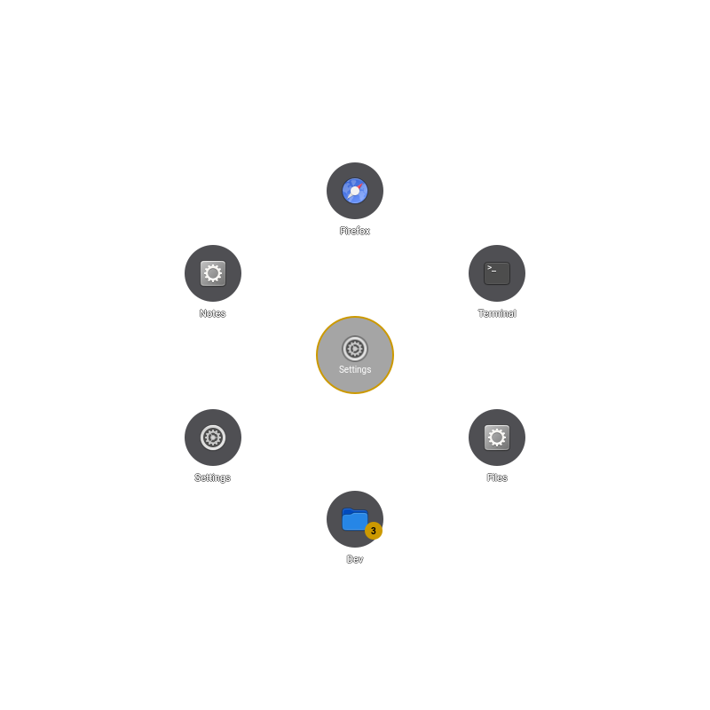
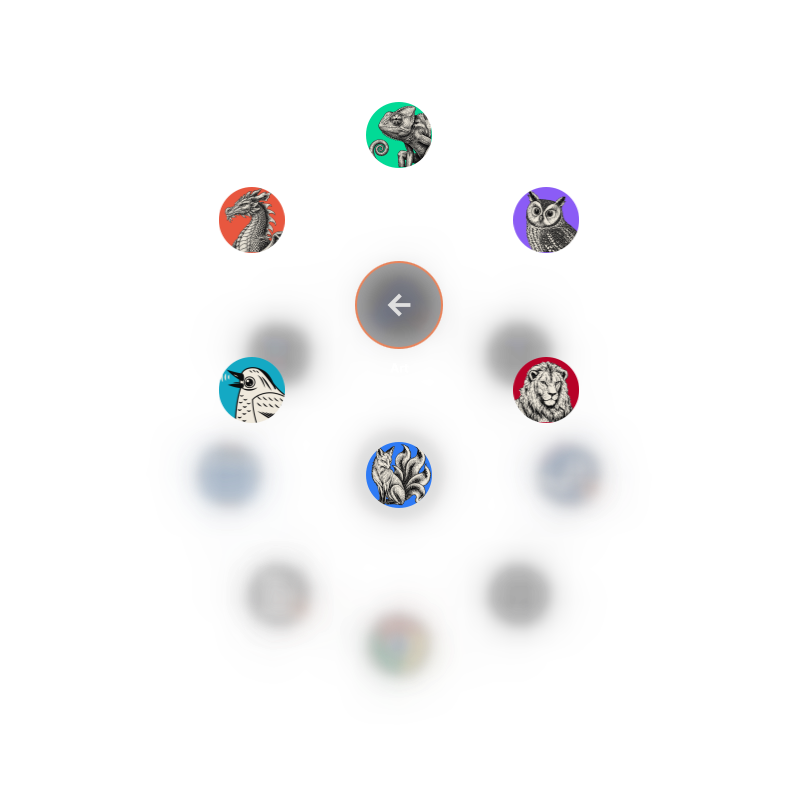

# Orbit — radial application launcher for Omarchy

**Orbit** — radial application launcher for Omarchy/Hyprland. A ring of cells around the pointer: each cell is either an application or a folder. Clicking a folder opens its own orbit, nesting is unlimited. Center of the ring — settings.

> Follows the Omarchy live theme accent color. Supports **English, Russian, Ukrainian**.

---

## Possibilities / Возможности / Можливості

| English | Русский | Українська |
|---------|---------|------------|
| Radial menu around the pointer | Радиальное меню вокруг курсора | Радіальне меню навколо курсора |
| Nested folders (orbit-in-orbit) | Вложенные папки (орбита в орбите) | Вкладені теки (орбіта в орбіті) |
| Live accent color from Omarchy theme | Акцентный цвет из темы Omarchy вживу | Колір акценту з теми Omarchy вживу |
| Language follows Omarchy settings | Язык следует настройкам Omarchy | Мова відповідає налаштуванням Omarchy |
| Show / hide cell names under icons | Показать / скрыть названия под иконками | Показати / приховати назви під іконками |
| Reorder, rename, remove cells | Переставить, переименовать, удалить ячейки | Переставити, перейменувати, видалити комірки |

---

## How to use / Как пользоваться / Як користуватися

- **Shift + Left click** — opens orbit under the pointer (default binding). Press the same combination again — closes.
- Click on a cell — launch application. Click on a folder — its orbit opens right around that folder's cell.
- **Escape** or click outside the ring — close.
- Center of the ring (Orbit icon) — open settings at root, or go up a level inside a folder.

---

## Settings / Настройки / Налаштування

Opened from the center of the ring. Available:

- **Activation combo** — any key mouse combination (Shift+LMB, Super+O, F9…). Binding in Hyprland is rewritten and reloaded instantly.
- **Menu editor** — add installed applications, folders, rename cells, take icon from any application, move ◀ ▶, delete. Saved immediately to `~/.config/orbit/menu.json`.
- **Show cell names** — enable/disable names under icons in the ring.

---

## Files / Файли / Файли

- `~/.config/orbit/menu.json` — menu tree.
- `~/.config/orbit/config.json` — activation combination.
- `~/.config/hypr/bindings.lua` — managed block (`-- >>> orbit-menu`) with binding and window rules. The rest remains your own.

---

## Build and install / Сборка и установка / Збірка та інсталяція

Requires Arch Linux + Hyprland (Omarchy recommended). Install `git` and `base-devel`, then:

```sh
git clone https://github.com/vyoltrava/orbit-tre.git
cd orbit-tre
./bin/install
```

`makepkg` resolves Qt and Hyprland dependencies, builds the package, and installs it. Launch **Orbit** from the app launcher. On first launch Orbit writes its activation bind. If Shift+LMB is taken, change the combo in Settings.

To build without installing: `./bin/build`. To run tests: `./bin/test`.

---

## Languages / Языки / Мови

Language is read from `~/.config/omarchy/language` (Omarchy Setup > Language). Catalogs:

- `src/i18n/en.json` — English
- `src/i18n/ru.json` — Русский
- `src/i18n/uk.json` — Українська

Add a new language by creating `src/i18n/<code>.json` with `"source text": "translation"` pairs.

---

## Screenshots / Скриншоты / Знімки екрана

 — Radial menu around the pointer / Радиальное меню вокруг курсора / Радіальне меню навколо курсора

 — A folder opens its orbit around its own cell while the previous level stays on screen, blurred / Папка открывает свою орбиту вокруг своей клетки, а прошлая ступень остаётся на экране под блюром / Тека відкриває свою орбіту навколо своєї комірки, а попередній рівень лишається на екрані під блюром

 — Settings panel: hotkey, cell names, menu editor / Панель настроек: комбинация, названия ячеек, редактор меню / Панель налаштувань: комбінація, назви комірок, редактор меню

---

Licensed under the MIT license; the theme and translator follow Omacut and Monologue (MIT, David Heinemeier Hansson).